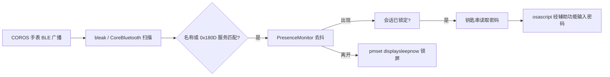

# coros-unlock

用一块高驰（COROS）手表通过蓝牙靠近自动解锁你的 Mac，并在离开时自动锁屏。

> 这是一个第三方个人项目，与 COROS Wearables Inc. 和 Apple Inc. 均无关联。

## 它到底做了什么

macOS 的“自动解锁”只对 Apple Watch 开放，第三方蓝牙设备没有系统级入口。本项目采用与其他第三方靠近解锁工具相同的可行路径：持续监听手表的 BLE 广播，在确认“手表在身边”后，通过辅助功能（Accessibility）把保存在 macOS 钥匙串里的登录密码输入到登录窗口。



## 能力边界（请先读）

- 只能解锁**已登录会话内的锁屏**（屏保/睡眠唤醒后的登录窗口）。
- 无法解锁 FileVault 预启动环境、重启后的首次登录、固件锁或 MDM 管理锁——这些阶段第三方进程根本不运行。
- 无法复刻 Apple Watch 的“自动解锁”，也不会出现在系统设置的 Apple Watch 列表里。
- 本项目在没有 BLE 硬件的环境中开发，BLE 与解锁部分需要在你的 Mac 上实测验证。

## 工作原理

1. **识别手表**：`bleak` 在 macOS 上走 CoreBluetooth，系统不暴露 MAC 地址，只有每台主机专属的 UUID。因此靠广播名称（如 `COROS PACE 3`）或标准心率服务 `0x180D` 识别。
2. **去抖**：连续 `present_after` 次广告才判定“在”，超过 `absent_after` 秒没收到才判定“离开”，避免信号抖动导致反复解锁。
3. **密码保管**：密码只存 macOS 钥匙串（服务名 `coros-unlock`），不进配置文件、不写日志；所有子进程均以参数列表调用，不经过 shell。
4. **解锁动作**：`osascript` 经 System Events 键入密码并回车，密码作为 argv 传入而非拼接进脚本文本。

## 安装

需要 macOS 13 或更高版本、Python 3.10+。

```bash
git clone https://github.com/<your-name>/coros-unlock.git
cd coros-unlock
python3 -m venv .venv
source .venv/bin/activate
pip install -e .
```

## 使用

```bash
# 1. 看看周围有哪些 BLE 设备
coros-unlock scan

# 2. 选择你的手表，身份写入 ~/.config/coros-unlock/config.json
#    若打算让手表工作在“广播心率”模式，加 --hr-only
coros-unlock pair [--hr-only]

# 3. 把 Mac 登录密码存入钥匙串
coros-unlock password

# 4. 前台试跑，确认整条链路
coros-unlock daemon

# 5. 没问题后安装 launchd 常驻
coros-unlock install
launchctl bootstrap gui/$(id -u) ~/Library/LaunchAgents/com.corosunlock.daemon.plist
# 或直接：bash scripts/install_launchd.sh
```

其他命令：`coros-unlock status` 查看配置，`coros-unlock uninstall` 移除常驻。

### 必需的系统授权

- **辅助功能**：系统设置 → 隐私与安全性 → 辅助功能，勾选运行 daemon 的终端（或 launchd 对应的 python）。
- **蓝牙**：首次运行时允许终端/ Python 使用蓝牙。
- **钥匙串**：首次读取密码时会弹窗，选择“始终允许”。

## 安全模型

这是一个**便利性换安全性**的工具，请在你物理上信任的 Mac 上使用：

- BLE 身份是可被伪造的，且 BLE 通信距离可达数十米；建议配合 `lock_when_away` 使用，并保留较短的 `absent_after`。
- 密码虽然只存钥匙串，但任何获得你用户会话且能调用该钥匙串项的进程理论上都能读取。
- 对安全要求高的机器，请直接使用 Apple Watch 自动解锁或触控 ID，不要使用本工具。

## 测试

纯逻辑部分（状态机、配置、匹配、命令构造）可在任意平台运行：

```bash
python3 -m unittest discover -s tests -v
```

## 故障排查

| 现象 | 处理 |
|---|---|
| 扫描不到手表 | 手表在“未连接任何设备”时才持续广播；可长按 BACK/LAP → 广播心率 |
| 配对后仍不解锁 | 先 `coros-unlock status`，确认钥匙串项存在、辅助功能已授权 |
| osascript 报 -1719 / 权限错误 | 终端或 Python 没有辅助功能权限，重新勾选后再试 |
| 重启后不工作 | 预期行为：FileVault 预启动阶段无法解锁，需手动登录一次 |
| 离开后不锁屏 | 检查配置里 `lock_when_away` 是否为 true，适当调小 `absent_after` |

## 免责声明

本软件按“现状”提供，不附带任何明示或暗示的担保。使用者需自行评估安全风险，并对因使用本软件造成的任何后果负责。COROS 与 Apple 均未参与本项目。
